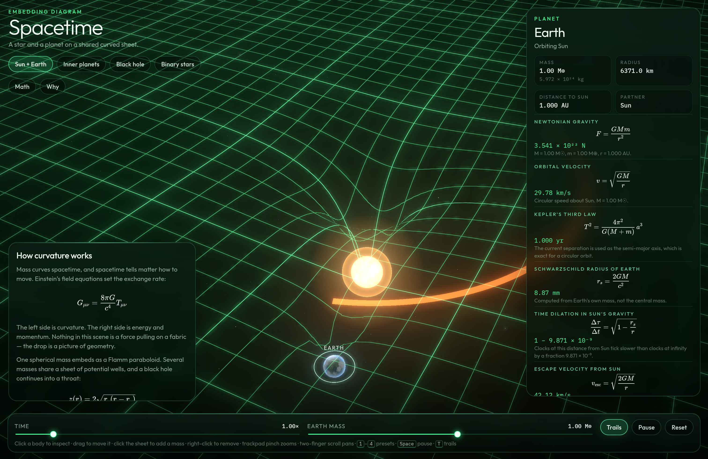
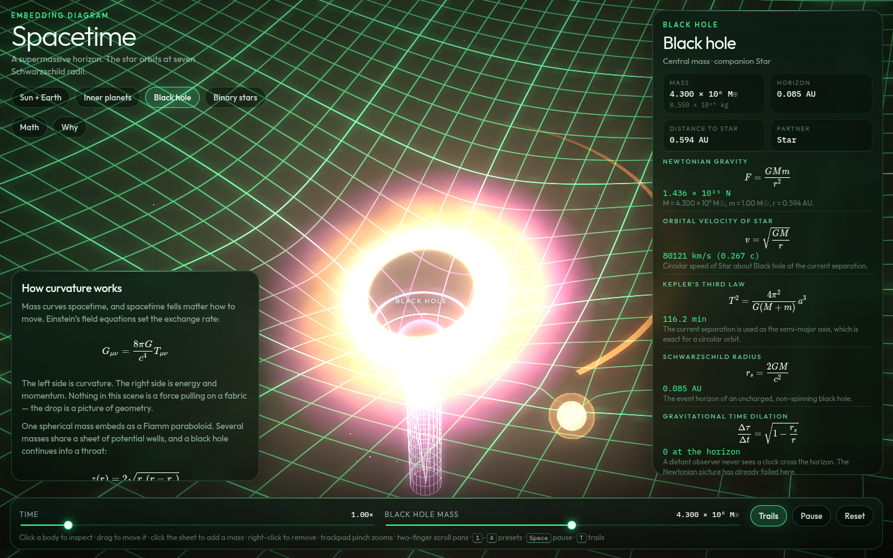

# Spacetime

An interactive embedding diagram of curved spacetime. Stars and planets sit in a neon-green grid on a black field. The sheet bends under each mass, in real time, while a glassy panel reads out the gravity of whatever you select.



The black-hole preset drops the same grid into a Flamm throat, with an event horizon and a star on a close orbit.



**Live demo:** [russellambriz.github.io/spacetime-curvature-3d](https://russellambriz.github.io/spacetime-curvature-3d/)

That URL starts serving after GitHub Pages is turned on. The deploy workflow is already on `main`, but the Actions token cannot create the Pages site itself. Someone with admin access on the repo needs to:

1. Open **Settings → Pages → Build and deployment** and set **Source** to **GitHub Actions**.
2. Re-run the **Deploy GitHub Pages** workflow.

After that, every push to `main` publishes the site.

## Run it locally

```bash
npm install
npm run dev
```

Open the URL Vite prints. `npm run build` writes a static site to `dist/`.

## What you can do

- Orbit with a drag or one finger. Pinch to zoom. Two-finger scroll on a trackpad pans; two fingers on a tablet pan and zoom together.
- Click or tap a body to inspect it. On a Mac, drag a body to move it. On iPad, press and hold, then drag; release a hold without moving to remove it.
- Click or tap empty sheet to add a mass on a circular orbit around the heaviest body. Right-click also removes a mass.
- Change the selected mass and the time scale. Trails can be toggled. Reset restores the preset. Panels collapse on iPad and can be opened from Math and Why.
- Keys: `1`–`4` presets, `Space` pause, `T` trails, `R` reset.

## Presets

| Preset | What it shows |
| --- | --- |
| Sun + Earth | One solar mass and the real Earth orbit, drawn so both wells are visible. |
| Inner planets | Mercury, Venus, Earth, and Mars, with distances in true proportion. |
| Black hole | A 4.3 million solar-mass horizon. The star orbits at seven Schwarzschild radii, so the throat is to scale with that orbit. |
| Binary stars | 1.5 and 1.0 solar masses around a common barycenter. |

## The math

The panel is rendered with KaTeX and updates from the live separation. Numbers use SI constants (G, c, and real masses). Distances on screen are scaled; a separation of one astronomical unit is reported as 1 AU even though the orbit is drawn to fit the view.

- Newtonian gravity, \(F = GMm / r^2\)
- Circular orbital speed, \(v = \sqrt{GM / r}\)
- Kepler’s third law, \(T^2 = 4\pi^2 a^3 / G(M+m)\)
- Schwarzschild radius, \(r_s = 2GM / c^2\)
- Gravitational time dilation, \(\sqrt{1 - r_s / r}\)
- Escape speed, \(v_{esc} = \sqrt{2GM / r}\)

The “How curvature works” note states Einstein’s field equations, \(G_{\mu\nu} = 8\pi G / c^4 \, T_{\mu\nu}\), and the shapes actually used on the sheet: a Flamm paraboloid for a black hole, and a softened potential well for stars and planets. Planetary dimples are drawn deeper than their true mass ratio so they stay visible. The readout does not use that exaggeration.

## Deploy

`.github/workflows/pages.yml` builds the site and deploys it with GitHub Pages on every push to `main`. The workflow asks `configure-pages` to enable Pages when it can. On this repository that call needs an admin to choose **GitHub Actions** as the Pages source first; see above.
