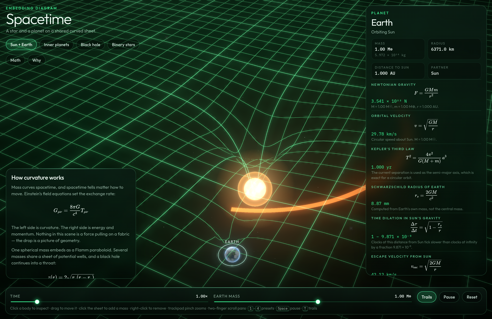
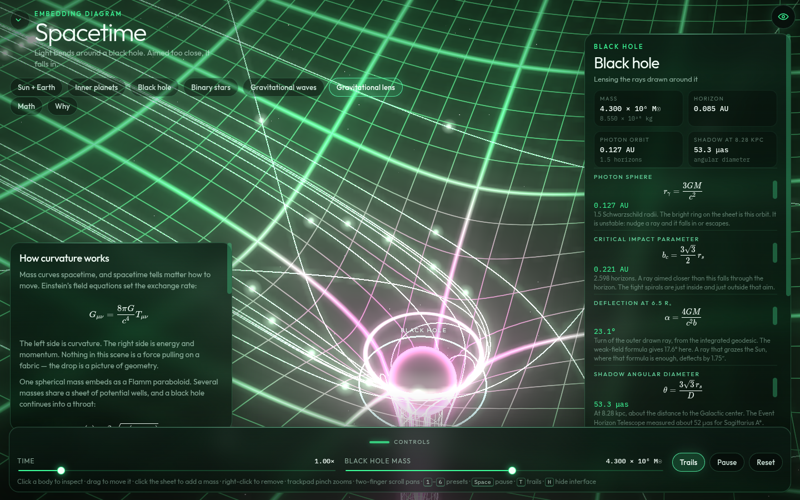
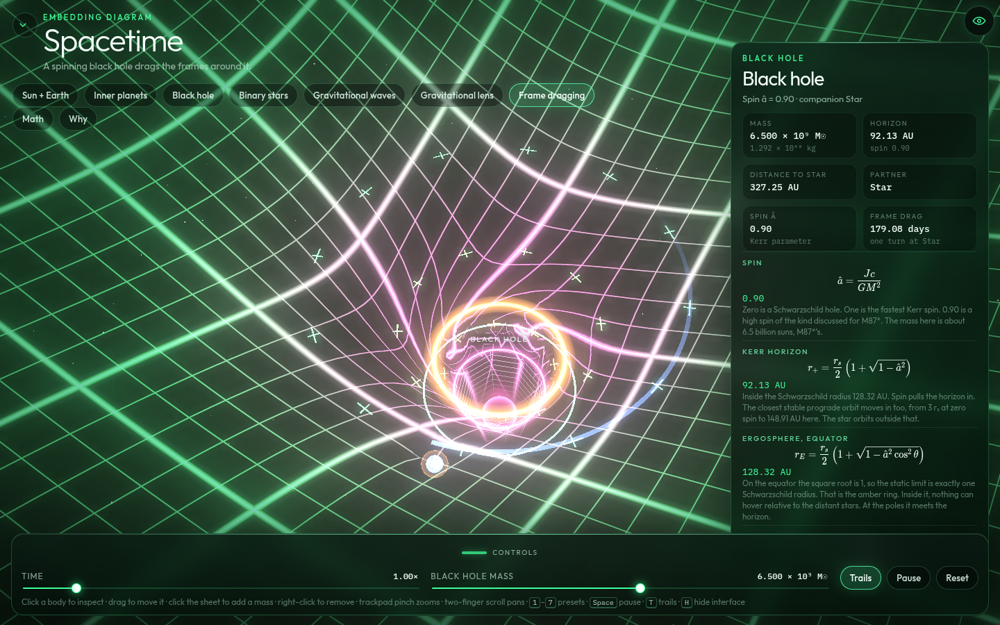
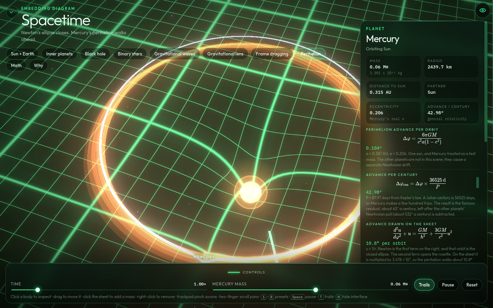
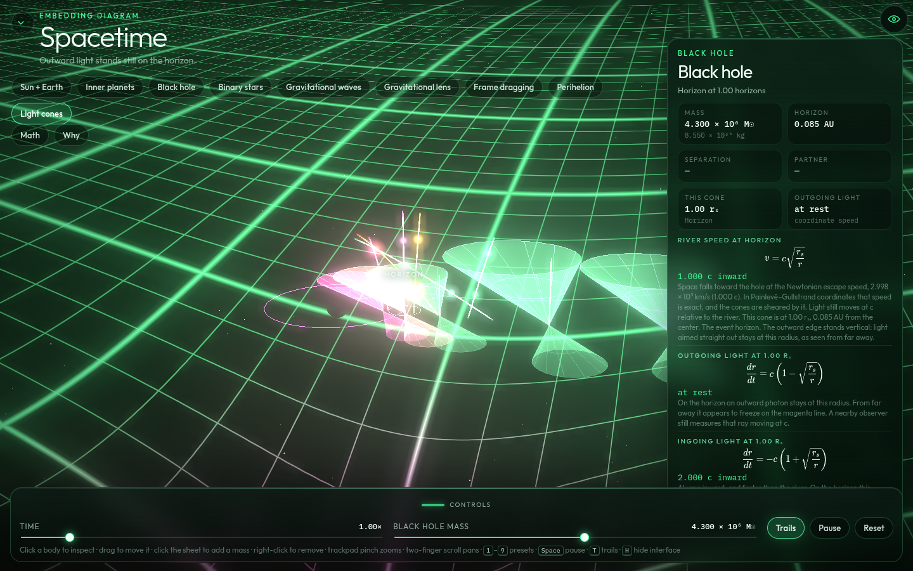
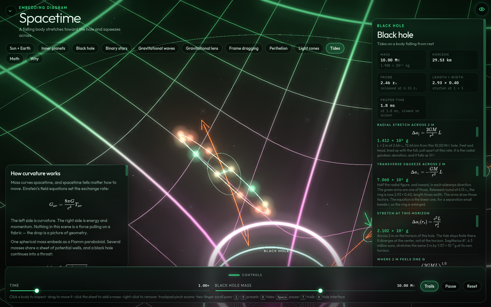
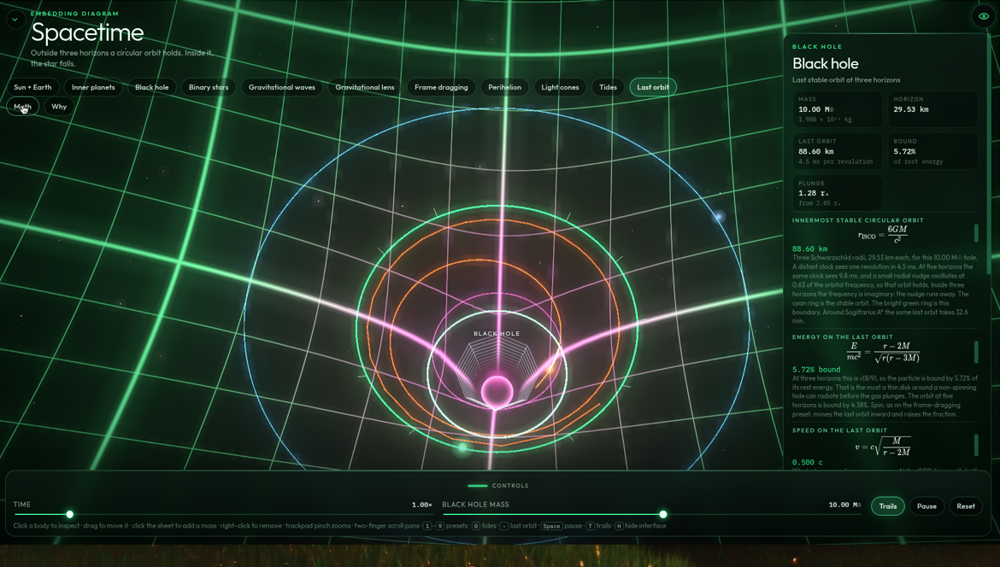
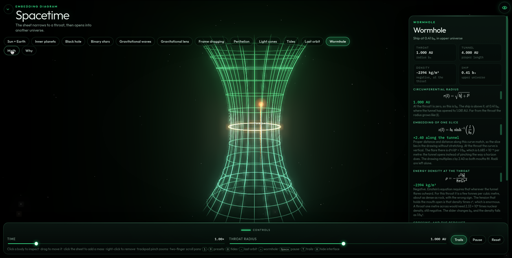
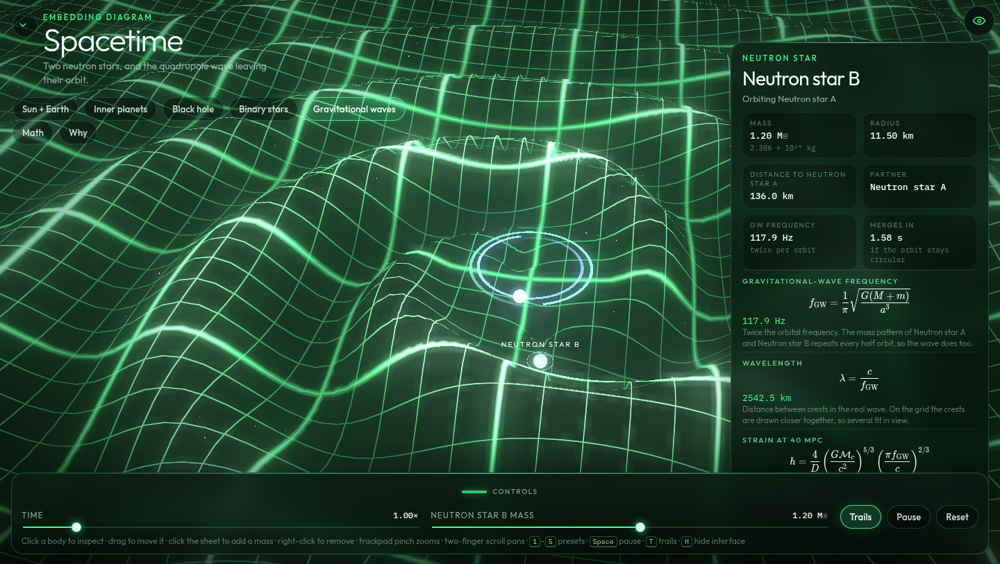
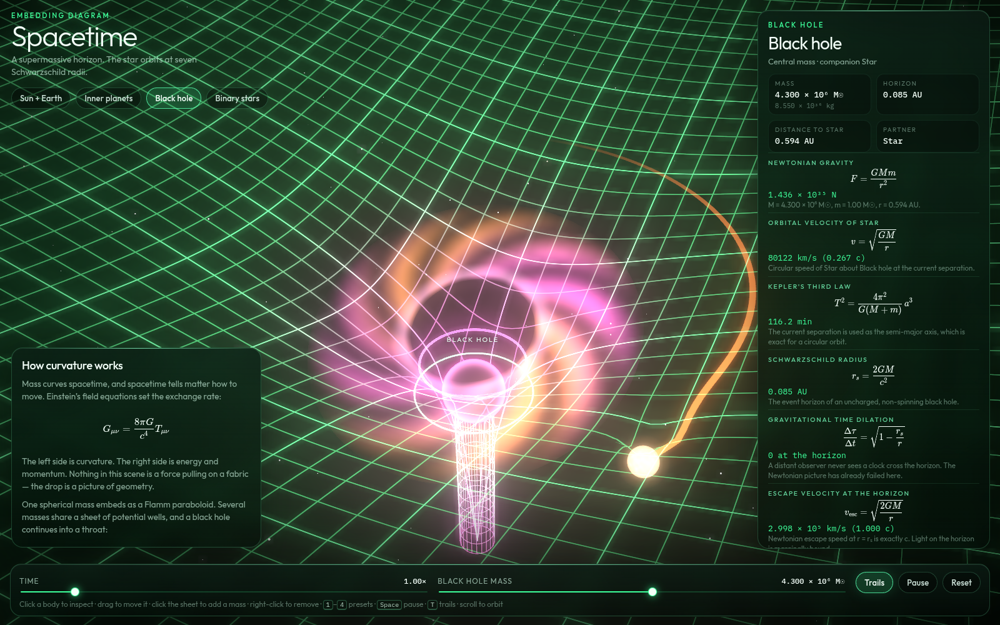

# Spacetime

An interactive embedding diagram of curved spacetime. Stars and planets sit in a neon-green grid on a black field. The sheet bends under each mass, in real time, while a glassy panel reads out the gravity of whatever you select.



The black-hole preset drops the same grid into a Flamm throat, with an event horizon and a star on a close orbit.

The gravitational-wave preset keeps that grid and draws the quadrupole ripple of a neutron-star pair: a two-armed spiral, twice per orbit, with the crests moving outward.

The gravitational-lens preset draws the null geodesics of a black hole on that same grid. Parallel rays come in from the left. Wide ones bend and escape. Rays aimed inside the critical impact parameter fall through the horizon, and a bright ring marks the photon sphere, where light can orbit.

The frame-dragging preset spins that hole. The horizon shrinks inside an amber ergosphere, the grid shears into a whirl, and ticks of local inertial frames are dragged ahead closer in.

The perihelion preset puts Mercury on the same sheet. A closed ellipse is the orbit Newton would keep. The orange trail is the relativistic one, and it does not close: the perihelion walks ahead.

The light-cone preset leaves the grid flat and stands the causal cones up from it. Time points up. On the horizon the outward cone is vertical. Inside, it points only inward.

The tides preset drops a round ring from rest around a ten-solar-mass hole. Orange arms stretch along the fall and green arms squeeze across. Feet reach the horizon first.

The last-orbit preset draws the innermost stable circular orbit of that same kind of hole. A cyan ring at five horizons holds. The bright green ring at three is the ISCO. An orange geodesic, released just inside it, peels away and falls in.

The wormhole preset turns the sheet into a tunnel. The grid narrows, stands vertical, and opens into a second universe. An amber ring marks the throat. An orange ship crosses it.



















**Live demo:** [russellambriz.github.io/spacetime-curvature-3d](https://russellambriz.github.io/spacetime-curvature-3d/)

That URL starts serving after GitHub Pages is turned on. The deploy workflow is already on `main`, but the Actions token cannot create the Pages site itself. Someone with admin access on the repo needs to:

1. Open **Settings → Pages → Build and deployment** and set **Source** to **GitHub Actions**.
2. Re-run the **Deploy GitHub Pages** workflow.

After that, every push to `main` publishes the site.

## Run it locally

```bash
npm install
npm run dev
```

Open the URL Vite prints. `npm run build` writes a static site to `dist/`.

## What you can do

- Orbit with a drag or one finger. Pinch to zoom. Two-finger scroll on a trackpad pans; two fingers on a tablet pan and zoom together.
- Click or tap a body to inspect it. On a Mac, drag a body to move it. On iPad, press and hold, then drag; release a hold without moving to remove it.
- Click or tap empty sheet to add a mass on a circular orbit around the heaviest body. Right-click also removes a mass.
- Change the selected mass and the time scale. Trails can be toggled. Reset restores the preset. Panels collapse on iPad and can be opened from Math and Why.
- The eye button hides every panel for a full-screen view. `H`, or a double-tap on empty space, does the same. The title and the bottom controls can also collapse on their own.
- Keys: `1`–`9` presets, `0` the tides preset, `-` the last-orbit preset, `=` the wormhole preset, `Space` pause, `T` trails, `R` reset, `H` hide the interface. On the light-cone preset, the left and right arrow keys move between cones.

## Presets

| Preset | What it shows |
| --- | --- |
| Sun + Earth | One solar mass and the real Earth orbit, drawn so both wells are visible. |
| Inner planets | Mercury, Venus, Earth, and Mars, with distances in true proportion. |
| Black hole | A 4.3 million solar-mass horizon. The star orbits at seven Schwarzschild radii, so the throat is to scale with that orbit. |
| Binary stars | 1.5 and 1.0 solar masses around a common barycenter. |
| Gravitational waves | A 1.4 and 1.2 solar-mass neutron-star pair. The grid carries the quadrupole wave their orbit sheds: a two-armed spiral, twice per orbit, crests moving outward. |
| Gravitational lens | Schwarzschild null geodesics around a 4.3 million solar-mass hole. Rays aimed inside \(b_c = 3\sqrt{3}\, r_s / 2\) fall in. The ring at \(1.5\, r_s\) is the photon sphere. |
| Frame dragging | A Kerr hole with spin \(\hat{a} = 0.90\) and the mass of M87*, about \(6.5 \times 10^{9}\) suns. The amber ring is the equatorial ergosphere. Ticks are local frames, dragged faster closer in. |
| Perihelion | Mercury, eccentricity 0.206, around one solar mass. The closed ellipse is Newton’s orbit. The orange trail integrates the Schwarzschild orbit equation, with the relativistic term enlarged so the perihelion’s walk is visible. The panel keeps the true 43″ per century. |
| Light cones | Painlevé–Gullstrand light cones of a 4.3 million solar-mass hole, the mass of Sagittarius A*. Up is later. The river speed is \(c\sqrt{r_s/r}\). On the horizon the outward ray stands still. Inside, the future cone points only in. |
| Tides | Geodesic deviation around a 10 solar-mass hole. A ring is released from rest at \(6.15\, r_s\). It stretches along the fall and squeezes sideways. Marks on the far side are the tide at that radius, falling as \(1/r^3\). |
| Last orbit | The innermost stable circular orbit of a 10 solar-mass Schwarzschild hole. The cyan ring at \(5\, r_s\) is stable. The bright green ring at \(3\, r_s\) is the ISCO, where a hovering observer measures \(c/2\). The orange curve has that orbit’s energy and angular momentum and is released at \(2.85\, r_s\), so it falls in. |
| Wormhole | A Morris–Thorne throat of radius 1 AU. The sheet is the catenoid \(r = \sqrt{b_0^2 + l^2}\), stretched by 2.40 along the tunnel so both mouths fit. The amber ring is the throat. A ship crosses the 4 AU tunnel at \(0.2c\). Clocks agree, because the redshift function is zero. |

## The math

The panel is rendered with KaTeX and updates from the live separation. Numbers use SI constants (G, c, and real masses). Distances on screen are scaled; a separation of one astronomical unit is reported as 1 AU even though the orbit is drawn to fit the view.

- Newtonian gravity, \(F = GMm / r^2\)
- Circular orbital speed, \(v = \sqrt{GM / r}\)
- Kepler’s third law, \(T^2 = 4\pi^2 a^3 / G(M+m)\)
- Schwarzschild radius, \(r_s = 2GM / c^2\)
- Gravitational time dilation, \(\sqrt{1 - r_s / r}\)
- Escape speed, \(v_{esc} = \sqrt{2GM / r}\)

On the gravitational-wave preset the panel also reads the live separation as a wave:

- Frequency, \(f_{GW} = 2 f_{orb}\)
- Wavelength, \(\lambda = c / f_{GW}\)
- Face-on strain at 40 Mpc, from the chirp mass
- Time to merger for a circular orbit, from Peters’ formula

The ripples are a diagram. Crests on the grid are drawn closer together than that true wavelength, so several fit in view, and the orbit is held steady instead of being played through the inspiral. The numbers stay in SI.

On the gravitational-lens preset the panel reads the hole as a lens:

- Photon sphere, \(r_\gamma = 3GM / c^2\)
- Critical impact parameter, \(b_c = 3\sqrt{3}\, r_s / 2\)
- Deflection of the outer drawn ray, compared with \(\alpha = 4GM / c^2 b\) and with a solar graze
- Angular diameter of the shadow at the distance of the Galactic center

The filaments lie on the embedding so they can be seen with the well. The bend itself is in the plane: those paths are the null geodesics, not tracks of things rolling downhill.

On the frame-dragging preset the panel reads the hole as Kerr:

- Spin, \(\hat{a} = Jc / GM^{2}\)
- Horizon, \(r_{+} = (r_s / 2)(1 + \sqrt{1 - \hat{a}^{2}})\)
- Equatorial ergosphere, which sits at \(r_s\)
- Frame-dragging period of a local inertial frame at the star, from the exact equatorial rate, with the far-zone limit \(2GJ / c^{2}r^{3}\) beside it

The whirl on the grid is a diagram, held to a spiral that stays readable. The ticks keep the \(1/r^{3}\) falloff, and the periods in the panel stay in SI. The star’s orbit is drawn as a Newtonian circle outside the prograde innermost stable orbit.

On the perihelion preset the panel reads Mercury’s orbit as a Schwarzschild test mass:

- Advance per revolution, \(\Delta\varphi = 6\pi GM / (c^{2} a(1-e^{2}))\)
- That advance over a Julian century, about 43 arcseconds
- The orbit equation, and the factor by which its relativistic term is enlarged on the sheet

The other planets are left out. Their Newtonian pull accounts for about 532″ per century of Mercury’s perihelion drift; the 43″ is the residual Einstein predicted. The orange curve falls a little short of the ellipse at the far end, because the enlarged term is no longer a tiny correction. The real advance would not change a shape you could see. The clock along the path is the simulation clock, not proper time.

On the light-cone preset the panel reads the cone you select:

- River speed, \(v = c\sqrt{r_s/r}\), the Newtonian escape speed, exact in these coordinates
- Outgoing light, \(dr/dt = c(1 - \sqrt{r_s/r})\)
- Ingoing light, \(dr/dt = -c(1 + \sqrt{r_s/r})\)
- The outward tilt from the time axis

The grid is one moment, not the Flamm embedding used by the other presets. Crests are not exaggerated: a 45° cone is the limit at infinity, and at a few horizons the tilt is still obvious. Coordinate speed on the diagram is not a local measurement. Nearby, light still moves at \(c\). The orange curve is a stone that fell from rest at infinity. The vertical spines are paths that stay at one radius. Inside the horizon that path leaves the cone.

On the tides preset the panel reads the falling ring as Schwarzschild geodesic deviation:

- Radial stretch across 2 m, \(\Delta a_{\parallel} = 2GM L / r^{3}\)
- Transverse squeeze, half of that and inward
- The same stretch on this hole’s horizon, beside Sagittarius A*
- The radius where a 2 m person feels one g of difference

The ring is enlarged so the stretch factors can be seen. Those factors are the linear solution, which assumes a separation small next to \(r\). The ring steps inward evenly in radius. Proper time is the number in the panel, and the fall on screen is slowed. A real drop from rest lingers far out and then plunges. Around this ten-solar-mass hole the one-g surface is hundreds of horizons out. Around Sagittarius A* a 2 m person can cross the horizon intact. The horizon is not where the tide becomes infinite.

On the last-orbit preset the panel reads the circular geodesics of a Schwarzschild hole:

- Innermost stable orbit, \(r_{\mathrm{ISCO}} = 6GM/c^{2}\)
- Specific energy there, \(\sqrt{8/9}\), a binding of about 5.72%
- Local orbital speed, \(c/2\) on the ISCO and the Keplerian period seen from far away
- The plunge from \(2.85\, r_s\), with proper time and the distant clock

The rings and the orange curve are the geodesics, laid on the embedding. The bead steps evenly in radius, and the loop is slowed, so the two turns of the spiral can be seen. Most of the proper time is the slow peel just inside the last orbit. A distant clock advances further and would not finish if the fall were followed onto the horizon. The real periods stay in the panel: a few milliseconds for this ten-solar-mass hole, about half an hour for Sagittarius A*. A marble rolling in the well would circle at any height. The stability is the geodesic, not the slope.

On the wormhole preset the panel reads the tunnel:

- Circumferential radius, \(r(l) = \sqrt{b_0^2 + l^2}\)
- The isometric embedding, \(z(l) = b_0 \sinh^{-1}(l/b_0)\), and the factor 2.40 by which the drawing stretches that length
- Energy density at the throat, \(\rho = -c^2 b_0^2 / (8\pi G r^4)\), negative
- Proper time to cross at \(0.2c\), and the redshift \(e^{\Phi} = 1\)

The throat radius on screen is one astronomical unit. The tunnel drawn from mouth to mouth is four. At that size the negative density is a few tonnes per cubic metre, about as dense as rock and with the wrong sign. The tension is that density times \(c^2\). A throat one metre across would need a couple of hundred million times nuclear density, still negative. The slider changes the throat, and the density falls as \(1/b_0^2\). The ship moves at constant proper speed. The pauses at the mouths are the animation. The grid fades where the drawing stops. The flare does not.

The “How curvature works” note states Einstein’s field equations, \(G_{\mu\nu} = 8\pi G / c^4 \, T_{\mu\nu}\), and the shapes actually used on the sheet: a Flamm paraboloid for a black hole, a softened potential well for stars and planets, and a catenoid for the wormhole. Planetary dimples are drawn deeper than their true mass ratio so they stay visible. The readout does not use that exaggeration.

## Deploy

`.github/workflows/pages.yml` builds the site and deploys it with GitHub Pages on every push to `main`. The workflow asks `configure-pages` to enable Pages when it can. On this repository that call needs an admin to choose **GitHub Actions** as the Pages source first; see above.
