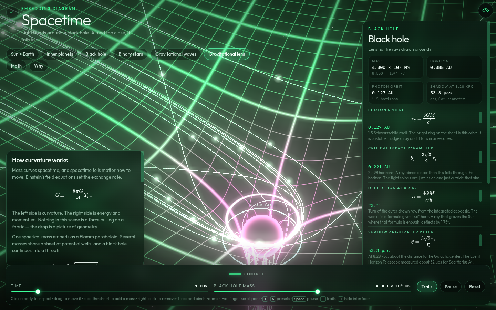
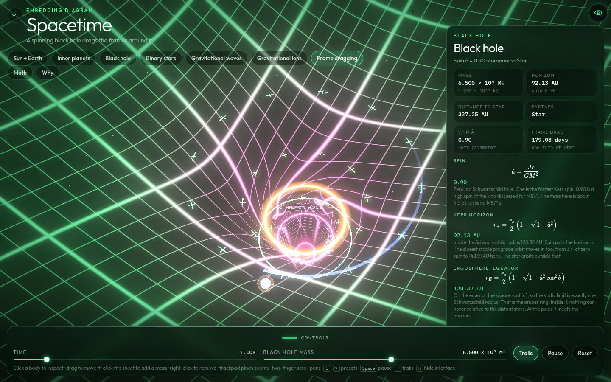
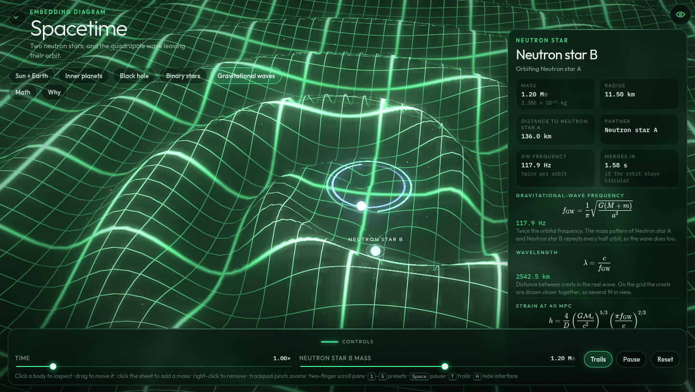

# Spacetime

An interactive embedding diagram of curved spacetime. Stars and planets sit in a neon-green grid on a black field. The sheet bends under each mass, in real time, while a glassy panel reads out the gravity of whatever you select.


The black-hole preset drops the same grid into a Flamm throat, with an event horizon and a star on a close orbit.

The gravitational-wave preset keeps that grid and draws the quadrupole ripple of a neutron-star pair: a two-armed spiral, twice per orbit, with the crests moving outward.

The gravitational-lens preset draws the null geodesics of a black hole on that same grid. Parallel rays come in from the left. Wide ones bend and escape. Rays aimed inside the critical impact parameter fall through the horizon, and a bright ring marks the photon sphere, where light can orbit.

The frame-dragging preset spins that hole. The horizon shrinks inside an amber ergosphere, the grid shears into a whirl, and ticks of local inertial frames are dragged ahead closer in.








**Live demo:** [russellambriz.github.io/spacetime-curvature-3d](https://russellambriz.github.io/spacetime-curvature-3d/)

That URL starts serving after GitHub Pages is turned on. The deploy workflow is already on `main`, but the Actions token cannot create the Pages site itself. Someone with admin access on the repo needs to:

1. Open **Settings → Pages → Build and deployment** and set **Source** to **GitHub Actions**.
2. Re-run the **Deploy GitHub Pages** workflow.

After that, every push to `main` publishes the site.

## Run it locally

```bash
npm install
npm run dev
```

Open the URL Vite prints. `npm run build` writes a static site to `dist/`.

## What you can do

- Orbit with a drag or one finger. Pinch to zoom. Two-finger scroll on a trackpad pans; two fingers on a tablet pan and zoom together.
- Click or tap a body to inspect it. On a Mac, drag a body to move it. On iPad, press and hold, then drag; release a hold without moving to remove it.
- Click or tap empty sheet to add a mass on a circular orbit around the heaviest body. Right-click also removes a mass.
- Change the selected mass and the time scale. Trails can be toggled. Reset restores the preset. Panels collapse on iPad and can be opened from Math and Why.
- The eye button hides every panel for a full-screen view. `H`, or a double-tap on empty space, does the same. The title and the bottom controls can also collapse on their own.
- Keys: `1`–`7` presets, `Space` pause, `T` trails, `R` reset, `H` hide the interface.

## Presets

| Preset | What it shows |
| --- | --- |
| Sun + Earth | One solar mass and the real Earth orbit, drawn so both wells are visible. |
| Inner planets | Mercury, Venus, Earth, and Mars, with distances in true proportion. |
| Black hole | A 4.3 million solar-mass horizon. The star orbits at seven Schwarzschild radii, so the throat is to scale with that orbit. |
| Binary stars | 1.5 and 1.0 solar masses around a common barycenter. |
| Gravitational waves | A 1.4 and 1.2 solar-mass neutron-star pair. The grid carries the quadrupole wave their orbit sheds: a two-armed spiral, twice per orbit, crests moving outward. |
| Gravitational lens | Schwarzschild null geodesics around a 4.3 million solar-mass hole. Rays aimed inside \(b_c = 3\sqrt{3}\, r_s / 2\) fall in. The ring at \(1.5\, r_s\) is the photon sphere. |
| Frame dragging | A Kerr hole with spin \(\hat{a} = 0.90\) and the mass of M87*, about \(6.5 \times 10^{9}\) suns. The amber ring is the equatorial ergosphere. Ticks are local frames, dragged faster closer in. |

## The math

The panel is rendered with KaTeX and updates from the live separation. Numbers use SI constants (G, c, and real masses). Distances on screen are scaled; a separation of one astronomical unit is reported as 1 AU even though the orbit is drawn to fit the view.

- Newtonian gravity, \(F = GMm / r^2\)
- Circular orbital speed, \(v = \sqrt{GM / r}\)
- Kepler’s third law, \(T^2 = 4\pi^2 a^3 / G(M+m)\)
- Schwarzschild radius, \(r_s = 2GM / c^2\)
- Gravitational time dilation, \(\sqrt{1 - r_s / r}\)
- Escape speed, \(v_{esc} = \sqrt{2GM / r}\)

On the gravitational-wave preset the panel also reads the live separation as a wave:

- Frequency, \(f_{GW} = 2 f_{orb}\)
- Wavelength, \(\lambda = c / f_{GW}\)
- Face-on strain at 40 Mpc, from the chirp mass
- Time to merger for a circular orbit, from Peters’ formula

The ripples are a diagram. Crests on the grid are drawn closer together than that true wavelength, so several fit in view, and the orbit is held steady instead of being played through the inspiral. The numbers stay in SI.

On the gravitational-lens preset the panel reads the hole as a lens:

- Photon sphere, \(r_\gamma = 3GM / c^2\)
- Critical impact parameter, \(b_c = 3\sqrt{3}\, r_s / 2\)
- Deflection of the outer drawn ray, compared with \(\alpha = 4GM / c^2 b\) and with a solar graze
- Angular diameter of the shadow at the distance of the Galactic center

The filaments lie on the embedding so they can be seen with the well. The bend itself is in the plane: those paths are the null geodesics, not tracks of things rolling downhill.

On the frame-dragging preset the panel reads the hole as Kerr:

- Spin, \(\hat{a} = Jc / GM^{2}\)
- Horizon, \(r_{+} = (r_s / 2)(1 + \sqrt{1 - \hat{a}^{2}})\)
- Equatorial ergosphere, which sits at \(r_s\)
- Frame-dragging period of a local inertial frame at the star, from the exact equatorial rate, with the far-zone limit \(2GJ / c^{2}r^{3}\) beside it

The whirl on the grid is a diagram, held to a spiral that stays readable. The ticks keep the \(1/r^{3}\) falloff, and the periods in the panel stay in SI. The star’s orbit is drawn as a Newtonian circle outside the prograde innermost stable orbit.

The “How curvature works” note states Einstein’s field equations, \(G_{\mu\nu} = 8\pi G / c^4 \, T_{\mu\nu}\), and the shapes actually used on the sheet: a Flamm paraboloid for a black hole, and a softened potential well for stars and planets. Planetary dimples are drawn deeper than their true mass ratio so they stay visible. The readout does not use that exaggeration.

## Deploy

`.github/workflows/pages.yml` builds the site and deploys it with GitHub Pages on every push to `main`. The workflow asks `configure-pages` to enable Pages when it can. On this repository that call needs an admin to choose **GitHub Actions** as the Pages source first; see above.
